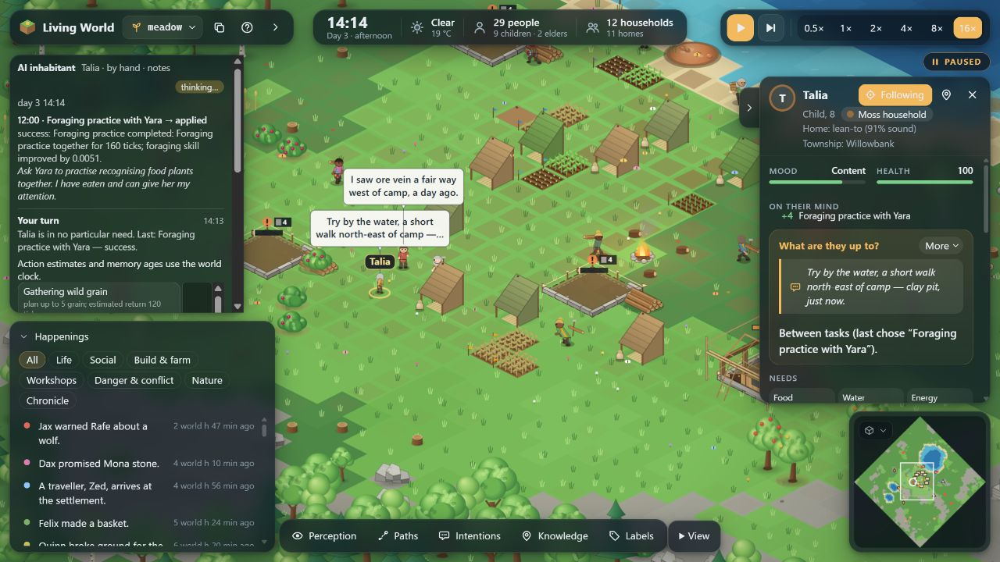
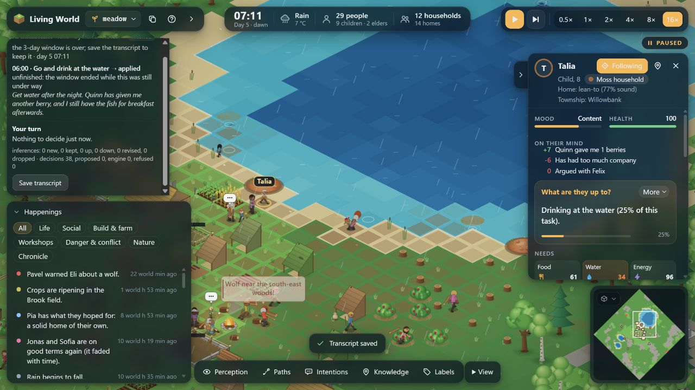

# Talia: implementation and a second lived experience

This is a separate-branch implementation and rendered manual life test. Talia is eight,
in household Moss, with parents Yara and Quinn and sibling Wes. I chose only options
offered through the actual LiveSession inhabitant controller; the other inhabitants
continued autonomously. The observations cover three world days, not a whole lifespan.

## Provenance and delivery

Worktree: `C:\dev\Claude Experiment\living-world-talia`.
Branch: `feature/talia-lived-childhood`.
Base: `c3f1310709831d7e90be2bdcbc023f33c8a391a8`, the verified Pavel rules-117 increment
and exact source of Talia's previous visit. The separate rules-118 repair checkout and
its untracked evidence were preserved. Main was not merged or pushed.

Rules 119 (`3b78731`) adds the childhood capability and food/replay/quiet/clock repairs.
Its complete three-day browser visit revealed a further resumed-gathering result defect.
Rules 120 repairs that defect while retaining the immutable rules-119 continuation.
Life-test source, settings, artifact hashes and commands are recorded in `provenance.json`.

## What changed, and what it means to an inhabitant

* A small child can carry one unreserved surplus food portion home while keeping food
  for themselves. The ordinary walk, arrival, ownership, capacity and transfer still
  happen. Promised goods are protected. The child no longer withholds their own meal
  merely because a sibling also lives in the household.
* A child can initiate family time, a guessing game with a sibling or another visible
  child, and food-plant practice with a familiar adult. Invitations can fail or be
  declined. Completed family time and games require 120 shared ticks; lessons need 160.
  Completed time affects the real relationship, social need, a fading thought and
  later choices. Lessons add a small actual foraging gain, capped by the teacher.
* A reserved child can seek quiet while the crowded feeling remains, choose a nearby
  explored place, and decline casual interruptions. Someone physically arriving can
  still end solitude; quiet is not magically guaranteed.
* The inspector now labels ages and deadlines with the same world clock as the
  inhabitant controller. Historical controller observations retain their wording.
* Rules 119 records routine measurements at four decimal places, eliminating the
  reproduced browser/Node hash discrepancy. The old rules-117 transcript is preserved
  unchanged and is not represented as a repaired historical replay.
* Rules 120 keeps a resumed gathering activity's already-paid acquisition in its
  outcome. Exhaustion after an earlier successful cycle is partial, not a false total
  failure. Inventory, claims and conservation use their existing owners.

See [the implementation contract](../docs/TALIA_LIVED_CHILDHOOD.md) for the causal
ownership chain, original finding dispositions, rules compatibility and review fixes.

## Evidence from the completed rules-119 visit

`life119-transcript.json` contains 42 applied decisions from tick 2400 to 9600.
The final hash is `074e00e6`; strict replay, independent reconstructed-save equality,
save round-trip, 120 further saved-continuation ticks and conservation all pass.

Talia brought food home, completed family time and play with Wes, completed family
time with Yara and a lesson from Yara. The lesson awarded only 0.0011 foraging skill
because Yara was only slightly more skilled at that moment. Quinn later truthfully
declined because they could not teach more. Kai was too busy for a requested game.
An attempted quiet interval ended when company came. A full home store caused a
partial food transfer. These are legitimate outcomes, retained in the evidence.

At tick 7633 the gathering record said failure although Talia had acquired one fish
before pausing for Wes's game. `fishing-trace.json` proves `cycle: 1`, inventory fish 1,
and the wrong failed ending. Rules 120 fixes this reproduced finding. The physical
regression first failed with “expected partial, received failed,” then passed after
the gather handler correction. The rules-119 recording continues to replay with its
original result; no recorded outcome or hash was edited.

## Final rules-120 visit

Runtime `7cd424b`, ordinary meadow, normal profile, immigration enabled, ticks
**2400–9600**. The rendered controller accepted **38/38 decisions**, with no rejected
submissions, transport fallbacks or retries. Their activity outcomes were 26 successful,
7 failed, 1 partial, 3 interrupted and 1 unfinished. An accepted controller choice is
not the same claim as successful execution.

| Experience | Recorded result |
| --- | --- |
| Small food contributions | Four completed home deposits, each leaving one surplus portion: two grain and two berry deliveries. Self-food remained in the pack. |
| Time with her sibling | Family time with Wes completed at 3121; their guessing game completed at 3349. Each paid 120 shared ticks. |
| Learning with a parent | Practice with Yara completed at 5502 after 160 shared ticks. Actual skill gain was 0.0051, capped by Yara's skill. Talia then gathered three berries at 5569. |
| Time with a parent | Family time with Quinn completed at 5773 after 120 shared ticks. |
| Other children's boundaries | Kai and Rafe declined because they had already played; Orla and Lena were too busy. No non-kin game completed in this manually controlled window. Ordinary autonomous Talia does complete non-kin games, as recorded below. |
| A difficult afternoon | A contested berry patch led to an argument with Felix. Talia later tried to make peace; the conversation ended sourly. The negative thought persisted and faded. |
| Food and self-care | Fishing produced three real fish; Talia ate two and retained one. She could eat her own carried food despite having a child sibling. |
| Quiet and danger | The quiet attempt was interrupted by nearby danger at 8185. Talia fled from a wolf, then successfully warned Wes at 8317. No solitude reward was fabricated. |
| End of the window | Health 100, food 61.4, water 34.3, energy 96.2. She had reached water and was drinking, but the activity was unfinished at 9600. Breakfast and the rest of that morning were not observed. |

Health was 100 in every answered decision and at the final state. Observed mood ranged
from **−15 to +9**; no decision offered only wandering. These are observations of this
visit, not proof of an improvement caused by the feature. The choices and resulting
trajectory differ from the original rules-117 visit.

Strict replay completes with **no warnings**, final hash **`e35d5f95`**. Two independent
replays yield identical complete serialized saves; save round-trip and 120 further
saved-continuation ticks match exactly. Resource conservation passes. The reconstructed
save SHA-256 is `a2f1d621370b0cd072c6a4ef28ae458ee8d2174caa9a2deee3d7500f44f2c110`.
The app also confirms **“World saved (day 5)”**; `browser-save.txt` records that UI state.





## What remains limited

The new choices do not guarantee that a particular person is free, willing or able to
teach. This visit's peer invitations did not complete; arranging future play time
could be a separate useful addition, but this implementation does not invent advance
appointments or override other children's daily boundaries. The capability itself
has physical non-kin completion tests and ordinary autonomous activation.

Quiet remains contingent on a safe place staying quiet. Shelter, household viability,
the wider repair programme, mature-world welfare and a full childhood are not claimed
complete. The original rules-117 recording still belongs to its original numeric
semantics; no old transcript hashes or continuation references were rewritten.

## Autonomous evidence and its limits

Separate ordinary meadow, river and forest worlds ran five days, then another 120
ticks alongside a restored save. The final rules-120 runs record 162, 130 and 154
childhood participant endings respectively, including unsuccessful endings. These are
recorded participant endings through tick 12120 (including continuation), not counts
of unique paired sessions or every pre-contact attempt. Meadow records 110 successful
and 52 interrupted endings, river 92/38, forest 116/38. All three preserve exact
serialized continuation and conservation.

Talia's retained meadow relationship with non-kin Eli records completed play at tick
7804. Her forest relationships retain two non-kin play experiences. This is ordinary
autonomous activation of play beyond siblings. It is not evidence that every child
gets enough family time or that childhood welfare improves across mature worlds.

## Verification and reproduction

Final branch full suite, including the app world-change repair: **380 files passed,
1 skipped; 2,380 tests passed, 1 todo; exit 0; 351.90 seconds**. TypeScript and production build pass. The existing skipped
file, todo, timeout-overflow warning in the budget test and bundle-size advisory were
not changed. Focused childhood/food/resumption/continuation coverage passes 38/38.
The complete earlier rules-119 run also passed (377 files, 2,372 tests); its additional
non-kin play regression and immutable continuation passed before the version-120 work.

Run from this worktree:

```powershell
npx vitest run --maxWorkers=8
npm run build
npx tsx talia_evidence/verify_life.ts talia_evidence/final-transcript.json
node talia_evidence/summarize.mjs
```

`verify_life.ts` uses strict `runReplay`: no source-drift permission, hash replacement,
or validation bypass. It reconstructs the final world twice, compares complete saved
bytes, checks a save round-trip and continues the original/restored copies for 120
ticks. The resulting `final-transcript-world.json` is a headlessly reconstructed save,
not a claim to have downloaded identical full save bytes from the browser.

The new visit uses the rendered controller directly. No resources, relationships,
needs, partner locations or completed activities were injected to make it succeed.

Forty exploratory files (early pilots, raw browser/Node hash traces, intermediate
saves and development logs) are preserved locally at
`C:\dev\Claude Experiment\living-world-talia-diagnostics-20261101` with a README.
They are separate from the final acceptance evidence committed on this branch.
The final build also strictly replays the complete rules-119 transcript unchanged.

### Saved-world controller boundary

Restoring the final save exposed a further app issue: a pending decision from a newly
started world remained visible after Load. The controller could subsequently rewind
over the loaded world. The final app now ends the prior session before any successful
world replacement, records its end against the old world, clears the pending request
and prevents a late answer from replacing the loaded world. Initial fast-forward is
also cancelled when a world is replaced.

This app-only correction leaves the simulation rules and the 38-decision recording
unchanged. The new Load/New World/initial-preparation contracts, existing controller
tests and current-world tests pass 33/33; save/storage/lineage tests pass 26/26; build
passes. The browser test starts with an unanswered decision, loads the saved day-five
world, and visibly confirms the old session has ended with no decision left waiting.
See `world-load-fixed.txt`, `world-load-fixed.jpg`, `world-change-tests.log` and
`world-change-save-tests.log`. The earlier completed-life provenance remains `7cd424b`;
this later app repair is separately committed.

The full suite was then rerun on the final app source: 380 files and 2,380 tests pass
(one existing skipped file and one todo), exit 0, 351.90 seconds. The raw result is
`full-suite-final-app.log` with exit status in `full-suite-final-app.exit`.

## Talia's feelings

The simulation records needs, mood thoughts and relationship experiences. It does not
establish subjective feelings. An imagined voice, grounded in the completed experiences:

> I can bring a little food home and still keep my breakfast. I can ask Wes to play,
> and I can ask my family to spend time with me. Sometimes people are busy, and
> sometimes they do not know more than I do. I like that saying yes means we actually
> stay together for a while. The argument with Felix still hurt, and trying to make
> peace did not fix it straight away. I still want a quiet place when I have had enough
> company, but I need it to be safe too.

This is interpretation, not generated in-world dialogue or evidence of consciousness.
